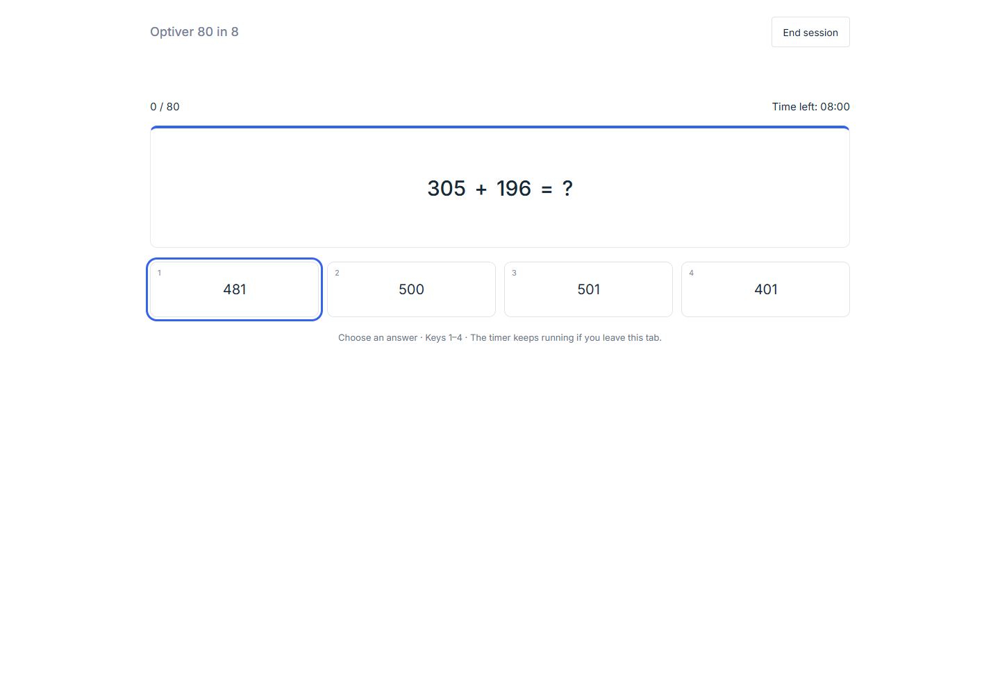

# zetacrack

A local mental-math practice app with Standard Zetamac, configurable Custom practice, and a distinct Optiver 80-in-8 mode. Sessions, exact questions, answers and descriptive analytics stay in a local SQLite database.

| Mode | Format | Answers and scoring |
| --- | --- | --- |
| Standard Zetamac | Two minutes; four operations with the original default question distribution | Type answers; correct answers advance automatically and add one point. |
| Custom practice | Weighted operations/groups, exact signed decimal ranges, presets, timed or endless sessions | Type answers; independently remembered settings and complete input replay. |
| Optiver 80 in 8 | 80 integer, decimal, fraction and missing-operand questions; eight minutes | Four choices; +1 correct, −1 incorrect, zero unanswered. Mouse and keyboard controls. |

Optiver has its own net-score history, accuracy, practice pass rate, response times, question-family breakdowns, pace by minute and filterable answer review. Its timer continues when you switch tabs; Standard and Custom end on focus loss. All modes support saved History and JSON/CSV exports, with separate comparison cohorts and explicit exclusions for interrupted or invalid runs.

The Optiver mode follows the visible [QuantPrep format](https://quantprep.io/mental_math_optiver_intro), using fresh seeded questions generated locally. The 56-point target is a practice target from that reference. Exact official question-bank parity, current hiring cutoffs and external score equivalence are unverified. See the [Optiver contract](adaptive-arithmetic/docs/stage-1-ai/OPTIVER.md) for the content, timing and measurement rules.

Saved Standard/Custom runs also offer question-level input replay, revisions, timing splits, ghost pace comparisons and manual practice from selected questions. These tools describe recorded performance; they do not establish learning benefit.

The frontend uses React and TypeScript; the backend uses FastAPI and SQLite. Practice records stay in a local, Git-ignored database. Descriptive analytics and manual practice tools are implemented; an adaptive learning system remains future research.

The application lives in [`adaptive-arithmetic/`](adaptive-arithmetic/). See its [README](adaptive-arithmetic/README.md) for setup, local startup and verification commands; the [platform contract](adaptive-arithmetic/docs/stage-1-ai/PLATFORM.md) for shared behavior; and the [Optiver verification report](adaptive-arithmetic/docs/reviews/2026-11-11-optiver-verification.md) for test evidence and limitations. Practice records, credentials, dependencies and generated builds remain outside Git.

[`CarryTheOne`](https://github.com/BennetC/CarryTheOne) was the precursor and is private. This public repository is named `zetacrack`.
