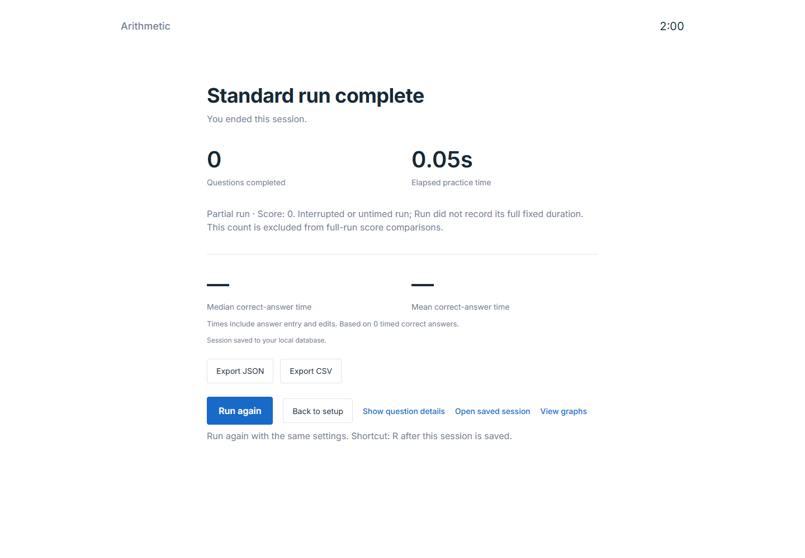
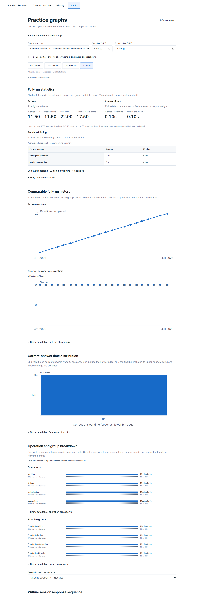
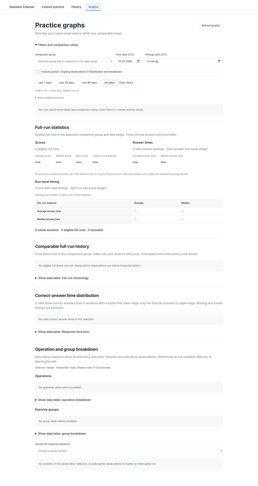
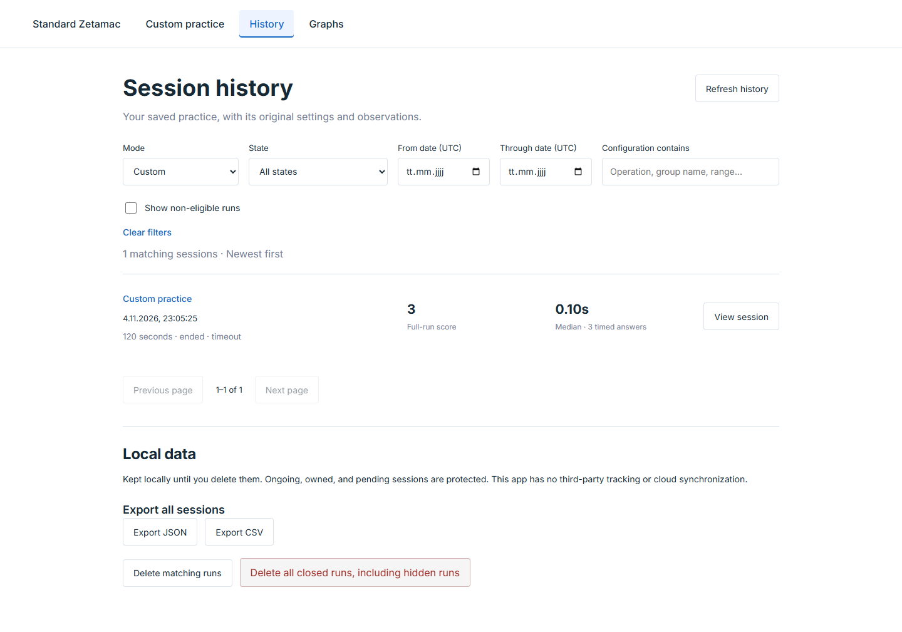
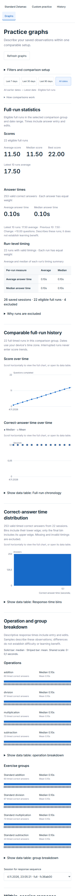

# Approved follow-up improvements — implementation and verification

Date: 2026-11-04. Authorization: the user said **“Approve all features”** after the eight-item review, recorded as D-026. All eight are implemented and verified. This is implementer verification, not an independent review or user acceptance of the delivered changes. The later performance investigation and Stage 2 learning system remain separate.

## Delivered behavior

1. **Graphs:** backend-derived best score, latest up-to-ten average, previous up-to-ten average and signed difference, with sample counts and conservative cohort/date boundaries. Last 7/30/90 days / All dates use inclusive UTC days. Mouse/touch/keyboard point inspection exposes the saved run and its numbers; tables remain available.
2. **Date selection:** reversed ranges show an inline error; no matching dates are distinguished from no saved history. Reset retains the selected comparison group.
3. **History filters:** Ongoing/Incomplete and Legacy selections enable non-eligible visibility. Switching that visibility off clears incompatible selections. Restored URLs normalize incompatible filter combinations. Clear filters restores the eligible-only default.
4. **Deletion:** an explicitly global button includes hidden runs; a separate matching-runs action previews every matching page under the current filters. Both require confirmation and preserve ownership/journal protections. New arrivals after the preview are excluded from the confirmed IDs.
5. **Navigation:** namespaced History/Graph query parameters, session IDs and return targets preserve context through reload and Back/Forward. Graph-opened detail returns to its graph selection; History-opened detail returns to its filtered page. Leaving an active run via Back finalizes its observations.
6. **Results:** Run again and R after terminal save create a fresh ID/seed with the same settings. Modified shortcuts, editable fields and held-key repeats are ignored. Save errors block repetition until resolved; pending creation/recovery feedback remains accessible.
7. **Creation reliability:** optional `creationKey` is stored durably before POST and reused with the original request/seed on retry. An additive nullable column and unique partial index atomically identify one retained session. Conflicting payloads return 409; legacy no-key requests keep prior behavior. Abandoned starts reconcile into ordinary observation recovery, while live owners remain protected.
8. **Mobile:** optional graph controls default collapsed at up to 700px. Quick ranges stay compact, numeric summaries precede exclusion details, and score values appear within the tested 390×844 first viewport. Controls expand and reflow without discarding filter state.

`PLATFORM.md` and `DATA_CONTRACT.md` define the exact interfaces and behavior. No arithmetic generator, content/policy/measurement version, or historic observation was changed.

## Actual checks

| Check | Result |
| --- | --- |
| Backend: `.venv/Scripts/python.exe -m pytest -q` | **102 passed**; one pre-existing dependency deprecation warning |
| Frontend: `npm test` | **24 passed**, including UTC boundary/range validation and damaged creation-metadata checks |
| New browser workflow: `npm run test:next-improvements` | **8 scenario groups passed**, zero page errors; [report](../../design/follow-up-2026-11-04/report.json) |
| Existing browser workflows | **54 checks passed**: baseline 10, recovery 8, exports 6, platform 13, review fixes 8, D-025 improvements 9 |
| Type/build/package | Typecheck and production build passed; **4 packaging checks passed** |
| Normal preview | [4175](http://127.0.0.1:4175), API 8019, existing normal SQLite; [read-only check](../../design/follow-up-2026-11-04/local-preview-check.json): new controls/statistics render, no page errors or API mutations |
| Historical data preservation | SQLite-aware backup saved under ignored `data/`; all original session/observation/preset/settings values matched pre-migration digests, [evidence](../../design/follow-up-2026-11-04/raw-record-preservation.json) |

The new browser scenarios reproduce a server commit followed by a deliberately dropped response, same-ID/seed retry, cross-tab protection of a pending creation, abandonment followed by same-record recovery, Run again/R state reset, numeric recent-window values, invalid/empty date selections, keyboard point activation, persistent details/filter return/Back/Forward, cooperating History filters, exact filtered deletion with hidden and arriving records preserved, explicit global-delete cancellation, mobile hierarchy and retained reload behavior.

The backend independently checks 16 concurrent same-key requests yielding one session, conflicting-key payloads, compatibility without keys, filtered deletion protection and two distinct score windows. Existing suites retain their arithmetic, immutable-prefix, focus/deadline, quota, clipboard, concurrent append, export and deletion checks.

Fresh existing-suite evidence is under [evidence-2026-11-04-follow-up](evidence-2026-11-04-follow-up/), preserving all earlier reports. Reproduce isolated replay preparation with:

```powershell
.\.venv\Scripts\python.exe scripts/prepare-improvements-replays.py --scratch data/follow-up-replays --evidence docs/reviews/evidence-2026-11-04-follow-up --include-improvements
```

Run the six generated suites sequentially. Each owns its database/ports/browser. The new browser harness is `web/tests/next-improvements-browser.mjs` and uses `design/follow-up-2026-11-04/`.

## Visual evidence

Actual final renders were inspected. Results actions wrap at the control level rather than splitting their labels; mobile ranges remain in one compact row and the first score values are visible without expanding filters.











## Repairs found during verification and limits

- A creation-to-observation recovery handoff initially retried ownership before the browser had completed releasing it. Ownership release now returns the actual Web Lock request-completion promise; the abandoned-start test passes after waiting for that handoff.
- The quota regression now waits for the closed page's actual browser lock to disappear before explicitly asking another page to recover it. This preserves the ownership contract rather than guessing from the page-close promise.
- The large-deletion fixture uses the migrated column count, and graph assertions distinguish interactive `group` SVGs from static `img` SVGs while still requiring the real charts and point buttons. These adapt tests to the approved interface changes.
- Mobile checks wait for the pinned-cohort response instead of racing its initial URL update. Scores were moved above exclusion details and quick ranges compacted to meet the observed first-viewport requirement.

Verified target remains Chrome/Windows with Web Locks. Keyboard activation and equivalent tables were exercised; universal screen-reader/contrast/browser certification is not claimed. Existing journal-unavailable/unacknowledged-exit limits remain, and historical orphan starts without a creation key are not guessed or rewritten. Creation-key idempotency lasts while its session is retained; deletion keeps no extra operation tombstones. Recent score comparisons describe the selected observations and do not demonstrate learning benefit.

The original 4173/8017 ports were already occupied by older services; they were left running. The updated 4175/8019 services were launched separately. Their supervised sessions at handoff are frontend 66468 and API 5888. No application checks used normal practice records for synthetic starts or deletion, and no cloud service, publication or Stage 2 implementation was performed.
