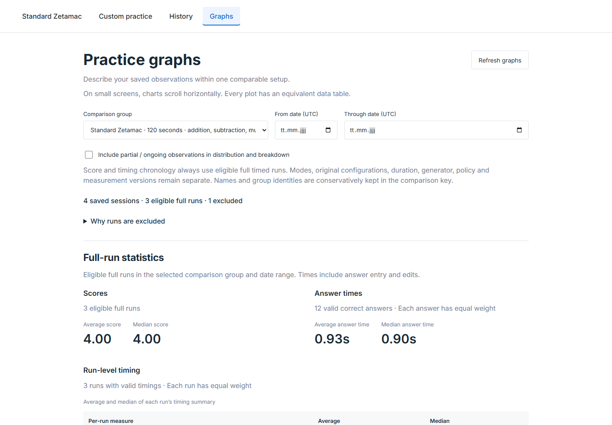
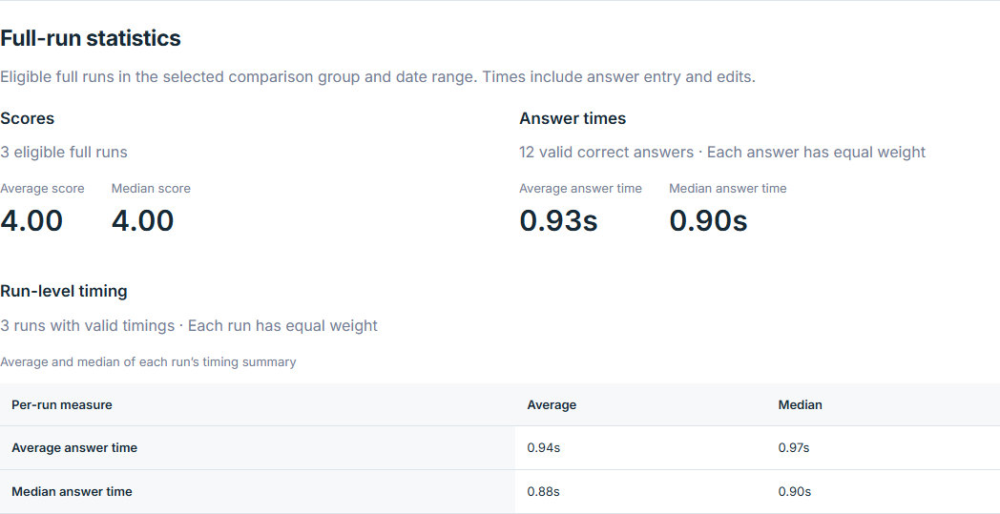
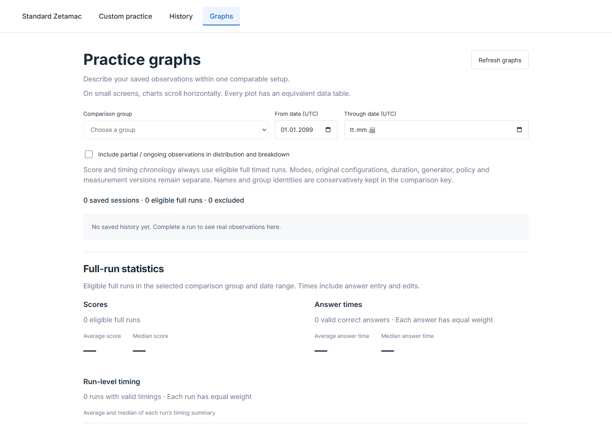
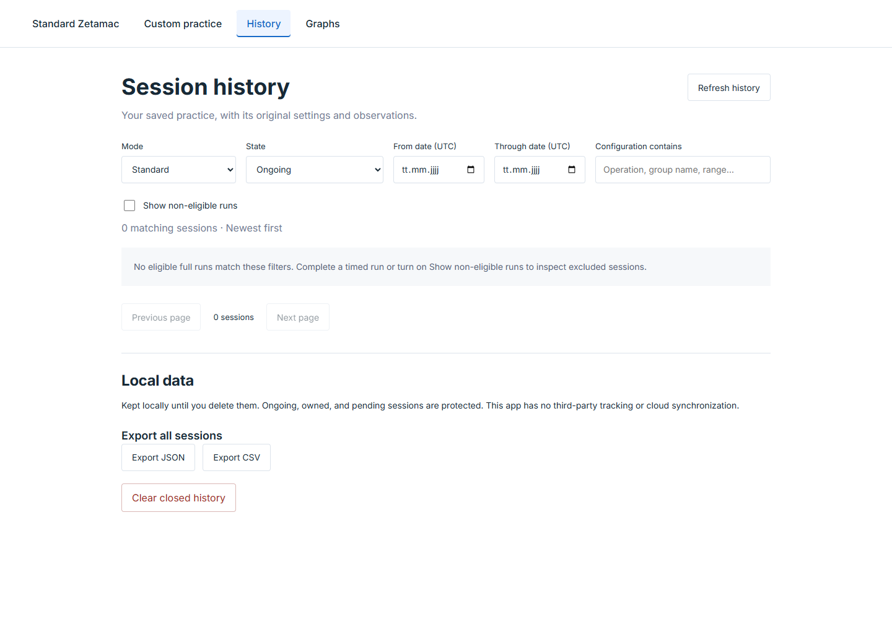
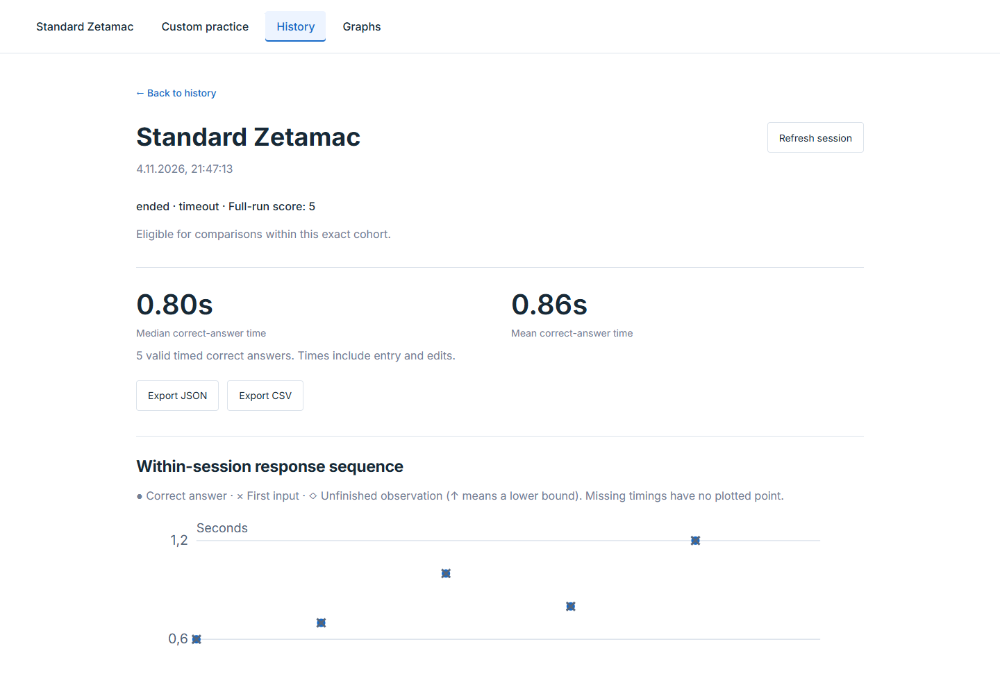
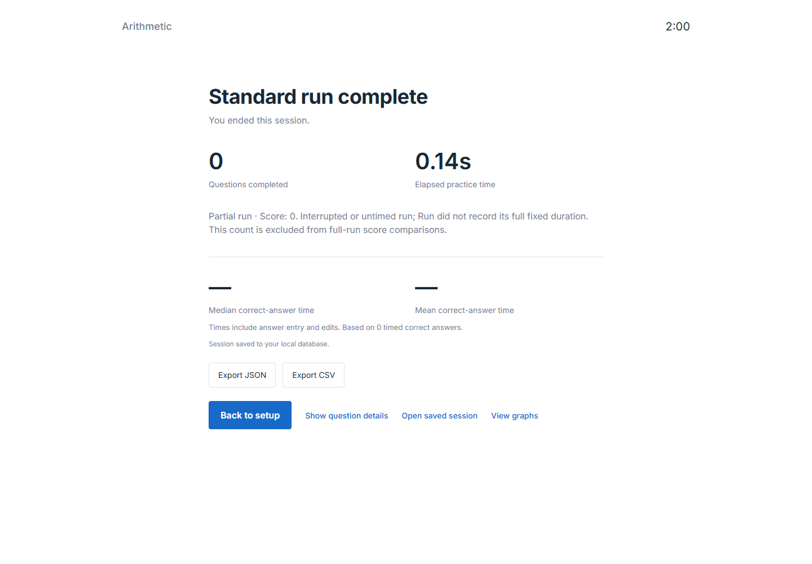
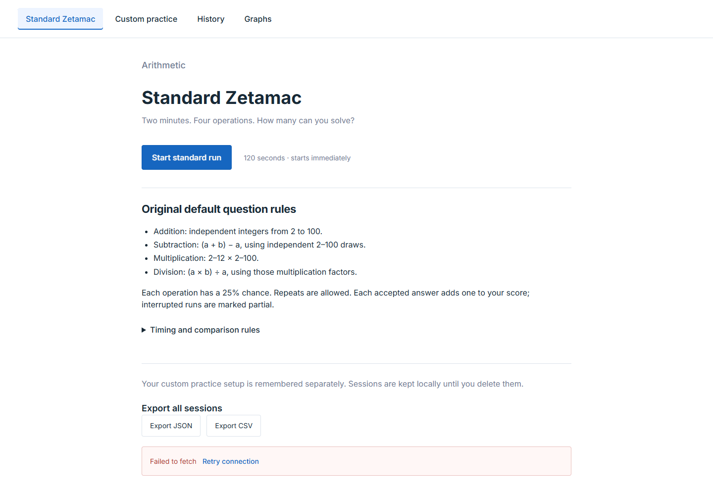
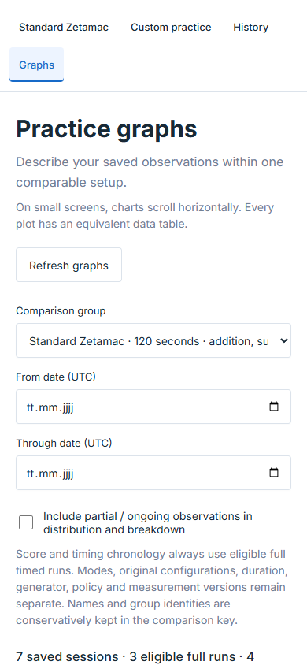

# Further improvements review — 2026-11-04

Reviewed the current working tree after D-025. This is a review and proposed backlog, not authorization or implementation of additional features. Application source and normal practice records were not changed. All browser actions used a fresh synthetic SQLite database, isolated API/Vite processes and a clean headless Chrome session. No in-app browser tools were available. Test processes were closed afterward.

The strongest next work is making session creation safe to retry, clarifying the scope of deletion, and improving filter behavior. The new numeric summaries and eligible-only default are useful foundations. Desktop layout is readable, tables remain available, exports are gated on persistence, and the 390px page has no document overflow.

## Prioritized findings

| Priority | Finding | Evidence and impact | Suggested improvement |
| --- | --- | --- | --- |
| High | Start is not safe to retry after a committed response is lost | **Reproduced.** The server created one session, then the browser's response was deliberately dropped. The client showed “Failed to fetch.” That session remained `open`, with zero events and no browser journal. Retrying created a different ID; the first stayed open. Such a row is also protected from normal deletion. | Generate and persist a stable creation-operation token before POST; have the API return the original session for retries of that operation. Keep seed/config fixed through the retry. Test “commit succeeded, response lost, retry” and recovery after page disappearance. Do not delete arbitrary open records to hide the symptom. |
| High | Deletion scope is broader than the filtered list | **Confirmed, currently intentional behavior rather than an API defect.** History showed zero Custom matches, but the deletion preview and native confirmation targeted four closed Standard records. Confirmation explicitly disclosed “all local history”; it was canceled. | Rename the existing action to “Delete all closed runs, including hidden runs.” Offer a separate “Delete matching runs” action if filtered cleanup is wanted, using an exact filtered preview and existing ownership protections. |
| Medium | Date-filtered empty graphs claim there is no history | **Reproduced.** Four records existed; setting From date to 2099-01-01 displayed “No saved history yet. Complete a run…” and disabled cohort selection. | Distinguish no history from no matches. Show “No runs match these dates,” keep the selected setup understandable, provide Clear dates, and validate reversed ranges. |
| Medium | History permits contradictory filters | **Reproduced.** State “Ongoing” can be selected while non-eligible runs remain hidden. The combination cannot return a row; the same conflict applies to incomplete/unknown ends. | Explain or prevent the contradiction: enable non-eligible visibility when these states are deliberately selected, or disable them with a clear explanation. Preserve the eligible-only default. |
| Medium | Session detail and filter context do not survive navigation/reload | **Reproduced for detail.** Opening a session left the URL as `?view=history`; reload returned to the list. Source also keeps dates, cohort, paging and detail selection in component state and uses `replaceState` for view changes. | Encode session ID and view/filter context in the URL, support browser Back/Forward, and return from graph-opened details to the original graph selection. Keep a deliberate reset path. |
| Medium | Results require returning to setup to practise again | **Confirmed.** The saved result's main action is Back to setup; there is no Run again action. | Add Run again with the same setup and a fresh ID/seed, plus a keyboard-accessible shortcut when results are active. Keep save/recovery status visible if another run starts. |
| Medium | Graphs describe all selected history but do not quickly answer “how am I doing lately?” | **Observed opportunity, not a defect.** The main measures are averages/medians across the selected range; there are no quick recent-period controls or best/recent comparison values. Chart points expose hover titles but no direct activation; the accessible table provides session links. | Add best score, last-10-run average, and latest-10 versus previous-10 descriptive comparison, with sample counts and consistent cohort boundaries. Add Last 7/30/90 days / All controls. Let mouse/touch/keyboard users inspect a point and open its session. These are descriptive comparisons, not evidence of learning benefit. |
| Medium | Mobile prioritizes filter explanations above the numeric results | **Observed at 390×844.** The first viewport contains navigation, copy, filters and exclusion explanation; numeric summaries are below it. There is no document overflow. | Collapse optional filters and methodology text behind clearly labeled controls, keeping active filter chips and the main numeric summary near the top. Preserve labels, access to all settings and chart data tables. |
| Later | History paging re-derives the entire database before returning a page | **Source finding; performance was not benchmarked.** `read_sessions()` loads every session and its observations, derives/enriches each, including per-session analytics; filtering and offset/limit happen afterward. | Before history grows substantially, measure realistic workloads and avoid repeating full-history derivation on every list read. Consider versioned derived summaries and database filtering/pagination while preserving exact eligibility and snapshot consistency. |

## Flow and screenshot evidence

All images below were captured in this review. The final result capture waits for its saved summary to load; the deletion capture waits until the canceled confirmation has settled. Screenshots are not substitutes for the recorded API/DOM observations.

### 1. Populated graphs — good foundation, opportunity to focus on recent performance

Readable numeric statistics, explicit sample counts and clear cohort boundaries are strengths. The comparison label is truncated and the surrounding methodology copy is relatively prominent. Add recent comparisons without pooling incompatible runs. Keyboard inspection found 14 plotted elements and zero point focus targets; equivalent tables mitigate access to the underlying values, but direct chart exploration is limited.

### 2. Empty graph date range — misleading message

The selected future range correctly yields no samples, but the message falsely implies that no history exists. Clear dates should be the next action. Missing aggregates correctly show dashes.

### 3. History state selection — contradictory controls

Ongoing and eligible-only can be selected simultaneously. The empty-state explanation mentions the checkbox, but preventing or explaining the conflict at selection time would be clearer. Mode/state/date controls have visible labels.

### 4. Filtered History and deletion — global scope needs stronger affordance

Zero Custom rows are visible. Clicking Clear closed history produced the following native confirmation, which was canceled: “Permanently delete these 4 closed sessions from all local history? 0 owned/pending sessions are protected. Presets and your custom setup remain.” No deletion was performed. The confirmation text is browser-dialog evidence, not pixels present in this screenshot.

### 5. Saved detail — useful content, unstable location

Timing, eligibility, exports and response sequence are accessible. The visible status includes internal terms such as `ended` and `timeout`; friendlier language would reduce friction without changing raw exports. Reload loses the selected session because its ID is absent from the URL.

### 6. Saved results — clear save status, extra steps before the next run

The app clearly distinguishes a partial run and missing timings. A fully loaded saved result exposes exports, question details, saved-session inspection and graphs. A Run again button would shorten repeated practice. The zero-answer result shown is synthetic.

### 7. Lost creation response — confirmed lifecycle gap

The screenshot shows the connection error; the underlying orphan is established by API/journal inspection, not by the screenshot alone. Recorded observations: one session created, status open, zero events, no journal, different ID after retry, original still open afterward. No previously answered questions were lost in this probe because the run had not yet begun.

### 8. Mobile graphs — fits the viewport, primary information is low on the page

At 390px there is no page overflow and controls have readable labels. The numeric statistics do not appear in the initial 844px viewport. Prioritize the numbers and expose optional filters/methodology on demand. Screenshot inspection does not establish contrast compliance, screen-reader behavior, or universal touch/keyboard accessibility.

## Code references and limits

- Creation and retry: `web/src/PracticeEditor.tsx:561–607`, `server/app.py:279–292`. Creation currently generates a new seed per Start attempt and a new server identity per POST.
- History scope: `web/src/SavedViews.tsx:150–178`, `server/app.py:345–349`. Deletion preview is global; confirmation correctly says so.
- Empty graph selection: `web/src/SavedViews.tsx:623–638, 737–742`.
- Detail/navigation state: `web/src/PracticeEditor.tsx:215–230`.
- Result action: `web/src/PracticeRun.tsx:475–478`.
- Point inspection: `web/src/Charts.tsx:320–378`; equivalent table follows.
- Full-history derivation: `server/app.py:314–343`, `server/analytics.py:104`.

[Machine-readable observations](evidence-2026-11-04-improvements/observations.json) contain the final probe results. The reproducible scratch harness is at `data/audit-2026-11-04/audit.mjs`; it creates its own synthetic database and processes. There were zero JavaScript page errors. The deliberate network fault is expected. This was a targeted review, not a rerun of the complete regression suite, a broad accessibility certification, a performance benchmark, or a Stage 2 learning-system review. Proposed statistics remain descriptive; no causal improvement claims are made.

Suggested first slice: retry-safe creation, explicit global deletion labeling, correct filtered-empty messages, and compatible History filters. Follow with Run again, persistent URLs, and a compact recent-performance view.
