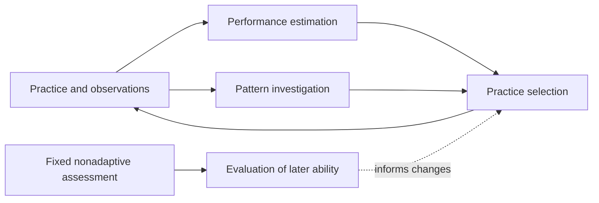

# Stage 2 — Research Brief

Status: Planning started 2026-10-23 following the user's Stage 1 acceptance (D-023). The first investigation, methodology, algorithm, and concrete study remain undecided. See [project state](../PROJECT_STATE.md) and the [planning kickoff](IMPLEMENTATION_PLAN.md).

## Ownership

The user personally investigates, designs, and implements the substantive mathematical, statistical, and algorithmic learning system. The agent defaults to research assistant, tutor, critical reviewer, and collaborator. Narrow implementation help requires an explicit request; do not turn this phase into an autonomous AI implementation sprint.

## Three distinct objectives

| Objective | Central question | Evidence boundary |
| --- | --- | --- |
| Predict performance | Can available information predict future question/session performance? | Prediction quality alone does not establish a real causal relationship or improved learning. |
| Investigate patterns | Is an apparent relationship reliable, and what explanations remain plausible? | Observed associations are hypotheses; discovery and confirmation need distinct evidence. |
| Improve future ability | Does a training approach improve later ability relative to an appropriate comparison? | Success on adaptively selected training questions alone does not demonstrate benefit; preserve independent fixed-distribution assessment. |

An adaptive interface establishes neither statistical validity nor learning improvement. Claims must match the objective and available evidence.

## Starting from the accepted platform

This is a map for discussion, not a selected system architecture or implementation backlog.

The user chose “Map the overall learning system, then choose a first investigation” on 2026-10-23. The map below describes responsibilities and evidence boundaries; it does not choose where they run, their algorithms, or their eventual interfaces.

Performance estimation asks what is likely to happen on a question given information available beforehand. Pattern investigation asks which candidate relationships survive further scrutiny and what explanations remain plausible. Practice selection needs an explicit training objective; a prediction that a question will be slow is not itself evidence that practising it will improve future ability. Evaluation tests the later outcome against a suitable comparison using an assessment matched to the intended skill. Standard mode is available, but a focused custom skill may require its own fixed assessment configuration.

| Responsibility | What Stage 1 supplies | Open Stage 2 question |
| --- | --- | --- |
| Observe practice | Exact questions, ordered input/presentation/acceptance events, unfinished observations, configuration/seed/version provenance, and JSON/CSV exports | Which observations and coverage are sufficient for the first question? |
| Estimate performance | Descriptive correct-answer and first-input timings; inspectable history and graphs | What future outcome should be predicted, and what information would be available at prediction time? |
| Investigate patterns | Reconstructable within-session question order and known fixed/random selection rules | Which candidate relationship matters, and what would distinguish it from alternative explanations? |
| Choose practice | Configurable content and a small fixed/random operation/group selection boundary | What should selection try to improve, and what evidence should justify changing it? |
| Evaluate later ability | An independent nonadaptive Standard mode and immutable custom configurations | What later assessment and comparison would count as a useful improvement for the user? |

The current `SelectionPolicy.choose(config, random)` in [domain.ts](../../web/src/domain.ts) selects an operation/group; it does not receive performance history or learned state. Operand generation remains separate. This is a starting boundary to inspect when a concrete investigation requires integration, not a complete adaptive-engine API. No extension is selected or implemented here.

The [measurement contract](../stage-1-ai/DATA_CONTRACT.md) remains authoritative: correct-answer time includes input and corrections; first-input time is not pure calculation time; edits do not define wrong attempts or an accuracy percentage; invalid intervals remain null and unfinished durations may be lower bounds. Existing comparison cohorts are descriptive platform rules, not automatically a Stage 2 study design. Actual practice-data volume and coverage have not been inspected for this planning checkpoint; synthetic test records are not user-performance evidence.

## Proposed first investigation — awaiting discussion

**Can question information predict the user's response time on later sessions better than a simple baseline?** A possible subsequent extension is whether information about preceding questions adds useful predictive value. The multiplication-by-12 example remains one candidate for later investigation, not a discovered effect.

The proposed purpose is to understand the measurement/data path and establish a reviewable prediction comparison before relying on performance estimates to choose practice. It would not establish why an association occurs or whether a training policy improves learning. No baseline, model family, features, split procedure, evaluation metric, sample requirement, or result is selected. The exact prediction target and treatment of unfinished/invalid work would need to be agreed explicitly; analysing only valid completed questions has a narrower scope than all presented work.

This is an agent proposal, not the user's selected first investigation. The next discussion should accept, revise, or replace the question before a study or implementation plan is drafted. Actual data coverage must be inspected before deciding whether existing practice records can support it.

## Example hypothesis

The user might answer multiplication-by-12 questions faster after addition than after difficult three-digit subtraction. This is a candidate sequential-effect hypothesis, not a finding or proof of causation. Question difficulty, typing demands, session position, fatigue, practice, and chance may explain the difference.

The future system should investigate whether such patterns are real before using them to design training. No effect size, model, or preferred intervention is assumed.

## Current planning discussion

Possible areas include performance estimation, sequential effects, uncertainty, controlled probing, exercise selection, and evaluation of learning outcomes. These are investigation areas, not an approved research plan. Overall-system mapping is the agreed starting point; the focused first investigation remains pending.

Using the accepted [Stage 1 handoff](../stage-1-ai/HANDOFF.md), discuss which focused question matters first, what the retained data can support, which additional observations or controls would be needed, and how much assistance the user wants. The default assistance remains research, teaching, critique, and review. Keep a nonadaptive baseline and transparent uncertainty in view without preselecting neural networks, reinforcement learning, or another model family.

Use [EXPERIMENTS.md](EXPERIMENTS.md) for evaluation guardrails and future records. The user's own sessions can support debugging and individual investigations; they do not alone establish benefit for other users. Do not invent findings, users, results, or portfolio claims.
